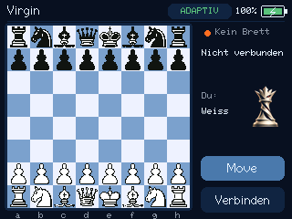

# M5Chess – Virgin auf dem M5Stack Core2

Eine eigenständige Schachanwendung von **Dirk D. Sommerfeld**. Die Virgin-Engine
läuft direkt auf dem Core2, immer im Adaptive-Modus. Zum Spielen werden weder
Handy noch PC, Internetzugang oder externe Engine-Netzdateien benötigt.

**[English documentation: build, installation and user guide](docs/ENGLISH.md)**



## Was das Gerät kann

- Grafisches Schachbrett mit scharfen Merida-Figuren und flackerfreier PSRAM-Darstellung.
- Manuelles Verbinden mit einem Bluetooth-Schachbrett; keine automatische Suche oder Wiederverbindung.
- Neue Partie durch Zurückstellen aller Figuren in die Grundstellung.
- **Move** übergibt die Seite am Zug an Virgin und dreht die Ansicht. So spielt Virgin auf Wunsch Weiß.
- Engine-Zug sofort auf dem Display, danach am echten Brett nachziehen.
- Suchtiefe, Bewertung aus Sicht von Weiß und Hauptvariante während der Suche.
- Logo-Dame in sechs Stimmungen aus Sicht des Spielers, ohne Farbbalken.
- Spectrum-Zug-LEDs mit Spielstandsfarben: blau bei ausgeglichener Stellung, Richtung Rot bei Nachteil und Richtung Grün bei Vorteil.
- Waagerechte Akkuanzeige oben rechts, Prozentwert und Ladeblitz; Aktualisierung alle fünf Sekunden, rot bei 20 % oder weniger.

## Benötigte Hardware

- **M5Stack Core2 mit klassischem ESP32, 16 MB Flash und PSRAM**. Dieses Projekt ist kein CoreS3-/ESP32-S3-Image.
- USB-Datenkabel für die Installation.
- Ein unterstütztes elektronisches Schachbrett für die Zugeingabe. Das Display bietet keine manuelle Zugauswahl auf den Feldern.
- Für Certabo/Spectrum eine kompatible BLE/UART-Bridge mit Nordic-UART-Service (NUS), wie beim eChessGateway. Ein USB-Kabel vom Brett direkt zum Core2 wird hier nicht unterstützt.

Die folgenden E-Boards sind mit M5Chess getestet:

| Brett | Unterstützung |
|---|---|
| Chessnut | Getestet. Suche nach `Chessnut`, unabhängig von Modellzusätzen. |
| Millennium über ChessLink | Getestet. Verbindung und Brettprotokoll über BLE. |
| Certabo | Getestet. BLE/NUS, Figuren-Einlernen und einfarbige LEDs. |
| Tabutronic Spectrum | Getestet. BLE/NUS, Figuren-Einlernen und RGB-LEDs mit Spielstandsfarben. |

## Quellcode holen

Git und Python 3.11 installieren. Dann im Terminal:

```sh
git clone --recurse-submodules https://github.com/parlue/M5Chess.git
cd M5Chess
python -m pip install -r requirements.txt
```

Die drei Bibliotheken sind als Submodule auf die getesteten Revisionen festgelegt.
Bei einem bereits geklonten Repository:

```sh
git submodule update --init --recursive
```

Ein GitHub-Download als ZIP enthält diese Submodule nicht. Für den einfachen
Nachbau deshalb den Git-Klon verwenden. Beim ersten Build werden ESP-IDF,
Toolchain und die durch den Komponentenmanager festgelegten Pakete geladen;
dafür ist ein Internetzugang erforderlich.

## Bauen und aufspielen

Alle Befehle werden im Repository-Hauptordner ausgeführt:

```sh
python -m platformio run -d esp32_core2
python -m platformio device list
```

Core2 über USB anschließen. Den angezeigten seriellen Port verwenden;
`COM17` ist hier nur ein Windows-Beispiel:

```sh
python -m platformio run -d esp32_core2 -t upload --upload-port COM17
```

Unter Linux/macOS stattdessen den dort ermittelten Port angeben, etwa
`/dev/ttyUSB0` oder `/dev/cu.usbserial-…`. Während des Aufspielens darf kein
anderes Programm den Port belegen. Das Aufspielen startet den Core2 neu.

Die getestete Konfiguration verwendet PlatformIO Core 6.2.0,
`espressif32@6.8.1` und ESP-IDF 5.3. Die Images entstehen unter
`esp32_core2/.pio/build/m5stack_core2/`. Für diese Flash-Aufteilung gehören
Bootloader an `0x1000`, Partitionstabelle an `0x8000` und Anwendung an `0x10000`;
der Upload-Befehl erledigt die Zuordnung.

Mit VS Code/PlatformIO kann alternativ `esp32_core2` als Projektordner geöffnet
werden. Der danebenliegende Ordner `src` enthält den benötigten Virgin-Code und
muss an seiner Position bleiben.

## Spielen

1. Core2 starten. Er wartet ohne Brettverbindung.
2. Brett einschalten und Verbindungen zu anderen Brett-Apps trennen.
3. **Verbinden** antippen und das gewünschte Brett in der Suchliste auswählen.
4. Figuren in die vollständige Grundstellung setzen. Standardmäßig spielst du Weiß.
5. Für Virgin als Weiß jetzt **Move** drücken: Du übernimmst Schwarz, die Anzeige dreht sich.
6. Eigene Züge auf dem Brett ausführen. Virgin zeigt seinen Antwortzug zuerst auf dem Display und markiert die auszuführenden Felder am Brett.
7. Den angezeigten Virgin-Zug vollständig nachziehen. Erst danach geht die Partie weiter.

Während Virgin rechnet, beendet **Move** die Suche vorzeitig. Bist du selbst am
Zug, übernimmt Virgin deine aktuelle Seite und du die Gegenseite. Ein bereits
angezeigter, noch nicht nachgezogener Engine-Zug muss zuerst am Brett ausgeführt
werden; in dieser Situation führt Move keinen weiteren Zug aus.

Für eine neue Partie alle Figuren wieder in die Grundstellung stellen. Der
Core2 löscht die Partie und beginnt mit dir als Weiß. Wiederholte identische
Grundstellungsmeldungen unterbrechen keinen schon gestarteten Eröffnungszug.
Eine Partie wird nicht dauerhaft gespeichert.

## Certabo und Spectrum einlernen

Bei jeder manuellen Verbindung werden die 34 Figuren-IDs neu gelernt. Beide
Modelle können in der Suchliste als `Certabo` erscheinen. Gewählt wird über die
Zusatzdamen in der vollständigen Grundstellung:

| Modell | Weiße Zusatzdame | Schwarze Zusatzdame |
|---|---|---|
| Certabo, einfarbig | d3 | d6 |
| Spectrum, RGB | e3 | e6 |

Aufstellung ruhig stehen lassen. Nach dem Einlernen blinken die Mittelfelder
dreimal. Beide Zusatzdamen entfernen; erst die normale Grundstellung gibt die
Partie frei. Eine unbekannte oder doppelt gelesene Figuren-ID wird nicht als
leeres Feld weitergegeben. Die Auswahl erfolgt nicht anhand von Paketgröße,
L/D-Markern oder der Bluetooth-Adresse.

Spectrum zeigt die Aufbauhilfe zunächst blau mit 80 % Helligkeit. Im Spiel
folgen die Zug- und Korrektur-LEDs der Bewertung aus deiner Sicht. Dabei wird
dieselbe Blaukorrektur wie in chesstactics verwendet, damit ausgeglichene
Stellungen auf den echten LEDs blau statt fast weiß erscheinen.

## Bewertung und Dame

Die Zahl neben dem Brett gilt **aus Sicht von Weiß**. Die Dame und die
Spectrum-Farben gelten dagegen **aus deiner Sicht**, auch wenn du Schwarz
spielst. Die Dame übernimmt nach Virgins Zug bevorzugt die Bewertung der
tatsächlich gewählten Adaptive-Variante. Diese kann von der angezeigten besten
Hauptvariante abweichen. Neue Partie und Remis setzen die Dame auf neutral;
Matt zeigt entsprechend Gewinn oder Verlust. Details und Schwellen stehen in
der [englischen Dokumentation](docs/ENGLISH.md#evaluation-and-queen-moods).

Der Akkuwert stammt aus der M5-Power-Bibliothek und ist eine Schätzung des
Ladezustands. Der Blitz bedeutet aktives Laden, nicht nur eingestecktes USB.

## Tests und Bildquellen

Die portablen Tests benötigen CMake ab 3.20 und einen C++20-Compiler:

```sh
cmake -S tests -B build/tests
cmake --build build/tests --config Release
ctest --test-dir build/tests -C Release --output-on-failure
```

Die sieben Testprogramme prüfen Spielmodell, Seitenwechsel, Neustart,
Damenbewertung sowie Certabo/Spectrum-Protokoll und LEDs. Der zuletzt installierte Akku-Stand
wurde auf einem Core2 gebaut, aufgespielt und per Displayaufnahme geprüft.

Die benötigten Bildtabellen liegen bereits im Quellcode; Pillow ist zum Bauen
der Firmware nicht erforderlich. Zum erneuten Erzeugen aus den mitgelieferten
WebP-Quellen:

```sh
python -m pip install -r requirements-assets.txt
python tools/generate_assets.py --check
python tools/generate_assets.py
```

## Lizenzen

Autor: **Dirk D. Sommerfeld**. Das Firmwarepaket wird unter GPL-3.0 bereitgestellt;
die ursprüngliche MIT-Lizenz des Virgin-Engine-Codes bleibt in `src/LICENSE`
erhalten. Merida-Figuren: Armando Hernandez Marroquin, GPL-2.0 oder später.
Weitere Quellen, Bibliotheken und Lizenztexte: [THIRD_PARTY.md](THIRD_PARTY.md).
